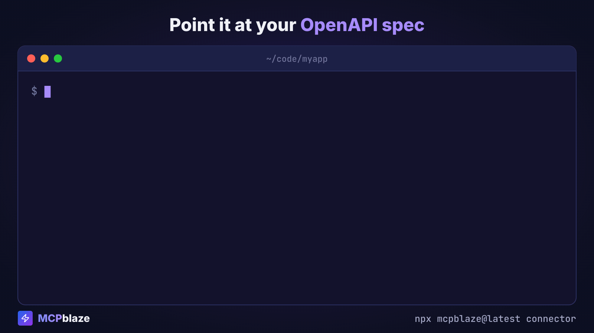

<p align="center">
  
</p>

<h1 align="center">MCPblaze</h1>

<p align="center">
  <strong>Get your API listed in Claude and ChatGPT.</strong><br>
  One command turns your OpenAPI spec into an MCP server with sign-in and per-user rules,
  checks it against the directories' published requirements, and writes your submission.
</p>

<p align="center">
  <a href="https://mcpblaze.com">Website</a> ·
  <a href="https://www.npmjs.com/package/mcpblaze">npm</a> ·
  <a href="https://www.apiblaze.com/docs#secure">Docs</a>
</p>

<p align="center">
  
</p>

## Quick start

**In your terminal**, point the wizard at your OpenAPI spec (a URL or a local file):

```bash
npx mcpblaze@latest connector https://ninopizzas.com/openapi.yaml
```

It creates the MCP server, then walks you through every open step of the Claude connector
checklist (add `--compliant chatgpt` for a ChatGPT plugin) and links the scorecard page where you
can finish. Stop any time: `npx mcpblaze connector <name> --status` shows what is left.

Only want the MCP server? `npx mcpblaze create --target ./openapi.yaml` makes one at
`https://<name>-<tenant>.mcpblaze.com/1.0.0/dev`. No login needed.

**In your agent**, add MCPblaze's own MCP server:

```bash
claude mcp add --transport http mcpblaze https://mcp.mcpblaze.com
```

Run `/mcp` in Claude Code and pick **mcpblaze** to sign in with GitHub. Then ask:

> Make an MCP server from https://ninopizzas.com/openapi.yaml and lock reservations to whoever
> made them. Then tell me what is left before I can submit it to the Claude directory.

Want to see it first? `npx mcpblaze demo` runs a small booking app on your machine with an MCP
server in front of it.

## Why

An MCP server exists to let an agent *do things*: book the table, cancel the order, change the
address. Most MCP servers reach the backend with one shared credential, so **every user of the
agent can take every action on every record**. The agent acting for Alice can cancel Bob's
reservation, and nothing in the stack knows the difference.

Fixing that by hand is three projects: an OAuth login for the MCP server, a way to know *which
person* is behind each tool call, and per-record rules that check it. MCPblaze does all three
from the spec you already have:

1. **An MCP endpoint**: your API's routes as tools.
2. **Sign-in**: callers sign in (GitHub by default, or your own OAuth or OpenID Connect
   provider), so every tool call carries a real person, not a shared key.
3. **Per-user rules**: whoever *created* a record is the only one who can view, change or
   delete it. Admins can override.

No AI guesses your security. The rules come from the shape of your spec (which routes create
things, which routes touch one thing by id), and you approve each one, written as a sentence,
before anything turns on. Your backend does not change.

## What it looks like

```text
$ npx mcpblaze create --target https://ninopizzas.com/openapi.yaml

Create an MCP server

? MCP server name: nino
→ Your MCP server will live at https://nino-<tenant>.mcpblaze.com/1.0.0/dev

? How should callers sign in?  Sign in with an account (OAuth)
? Which sign-in?  Hosted sign-in with GitHub
? Do you want to prevent unauthorized users from taking unauthorized actions?  Yes

  Reading your OpenAPI spec…
? Lock these to the person who created them (or an admin):
  ◉ restaurants — only the person who created a restaurant, or an admin, can view or change it
  ◉ restaurants/{restaurantId}/reservations — only the person who created a reservation, or an admin, can view, change or delete it
  ◉ restaurants/{restaurantId}/tables — only the person who created a table, or an admin, can change or delete it

✔ MCP server created!
  ✓ https://nino-ninodefaulttenant.mcpblaze.com/1.0.0/dev — callers sign in with GitHub
  ✓ restaurants, reservations + tables locked to their creator

? Connect an agent to it now?  Claude Code (detected)
  ✓ Claude Code connected — it will ask you to sign in with GitHub the first time you use it
```

From then on:

| The agent, acting for Alice, tries to… | Result |
|---|---|
| book a table (`POST /restaurants/{restaurantId}/reservations`) | **200**, and reservation 42 is recorded as Alice's |
| read, change or cancel reservation 42 | **200** |
| read or cancel Bob's reservation 43 | **403**: the agent is told plainly it isn't allowed |
| the same, when Alice is an admin | **200**: admins can act on anything |

## Getting listed in Claude and ChatGPT

`npx mcpblaze connector <name>` takes an MCP server through the directory checklist: your own
MCP hostname (one CNAME), sign-in on the connector, the listing answers pre-filled from your
spec, a reviewer account, a proof run that calls every tool, and the submission packet you paste
into each portal. It asks only for what is missing, saves every answer as you give it, and says
what is left at every step, in the terminal and on the scorecard page it links.

- `npx mcpblaze connector <name> --status` shows the scorecard and the page to finish on.
- `npx mcpblaze check <name> --directory-ready` prints the full readiness report: every blocker,
  with its fix.
- Add `--compliant chatgpt` for a ChatGPT plugin.

Passing the checks means the MCP server meets the requirements we can verify. You submit.
Anthropic and OpenAI decide.

## Tools

What your agent can do once it is connected to `https://mcp.mcpblaze.com`:

| Tool | What it does |
|---|---|
| `list_mcp_servers` | Lists your MCP servers: name, connector URL, status, and the scorecard page when one is being prepared for a directory. |
| `get_mcp_server` | Describes one MCP server in full: its URLs, how callers get in, its access rules and its admins. |
| `propose_access_rules` | Reads an OpenAPI spec and says, in plain sentences, which records can be locked to the person who created them. |
| `create_mcp_server` | Creates an MCP server from an OpenAPI spec with the rules you approved, optionally prepared for the Claude and ChatGPT directories, and returns its connector URL and scorecard page. |
| `apply_access_rules` | Changes the ownership rules on an existing MCP server, or switches them off. |
| `update_mcp_server` | Changes a server's name, target URL or on/off switch, or edits its tools (hide, rename, describe). |
| `delete_mcp_server` | Deletes an MCP server and everything attached to it, only after you say yes: it cannot be undone. |
| `get_readiness` | Says where an MCP server stands on the way to the Claude or ChatGPT directory: steps done out of 12, whether it is ready to submit, and the next step. |

The details (DNS, the listing fields, the reviewer account, the packet) are finished on the
scorecard page or with `npx mcpblaze connector`.

## Connect from other clients

`https://mcp.mcpblaze.com` uses Streamable HTTP and signs you in with GitHub through standard MCP
OAuth, so any client that supports remote MCP servers can connect.

<details>
<summary><b>Cursor</b></summary>

In `~/.cursor/mcp.json`:

```json
{
  "mcpServers": {
    "mcpblaze": { "url": "https://mcp.mcpblaze.com" }
  }
}
```

</details>

<details>
<summary><b>VS Code</b></summary>

In `.vscode/mcp.json`:

```json
{
  "servers": {
    "mcpblaze": { "type": "http", "url": "https://mcp.mcpblaze.com" }
  }
}
```

</details>

<details>
<summary><b>Codex</b></summary>

In `~/.codex/config.toml`:

```toml
[mcp_servers.mcpblaze]
url = "https://mcp.mcpblaze.com"
```

Then run `codex mcp login mcpblaze` to sign in.

</details>

<details>
<summary><b>Claude Desktop and claude.ai</b></summary>

Settings → Connectors → Add custom connector, then paste `https://mcp.mcpblaze.com`.

</details>

## What stays open

Rules cover *one record by id*. These stay reachable by any signed-in caller, and the CLI says so
in its output:

- Lists such as `GET /restaurants`. A list returns whole records, so if that matters to you, add
  a rule with `npx mcpblaze rule <name>`.
- Creating, such as `POST /restaurants/{restaurantId}/reservations`. Creating is how ownership
  gets recorded.
- Action-style routes such as `POST /search` or `POST /reservations/{id}/cancel`.
- Records that existed *before* the rules went on have no recorded creator, so only admins can
  touch them.

## Good to know

- **Your app runs on localhost?** `npx mcpblaze dev` puts an MCP server in front of it through a
  tunnel.
- **No account needed to start.** MCP servers made while logged out expire after 30 days unless
  you keep them: `npx mcpblaze login` offers to claim them into your account.
- **Not sure where to start?** `npx mcpblaze skills` checks your folder for an API and suggests the
  next step. Or tell your agent: *"Help me get my app listed in Claude and ChatGPT using
  npx mcpblaze@latest skills."*
- **Everything else:** `mcpblaze` runs the [`apiblaze`](https://www.npmjs.com/package/apiblaze)
  CLI under the MCP name and updates with it. `npx mcpblaze help --all` shows every command.

## About this repository

This repository holds MCPblaze's documentation and directory-listing files. The MCP server itself
is hosted at `https://mcp.mcpblaze.com`, and the CLI is published on npm as
[`mcpblaze`](https://www.npmjs.com/package/mcpblaze). MCPblaze is built by
[APIblaze](https://www.apiblaze.com). Questions: support@apiblaze.com.

The contents of this repository are released under the [MIT License](LICENSE).
